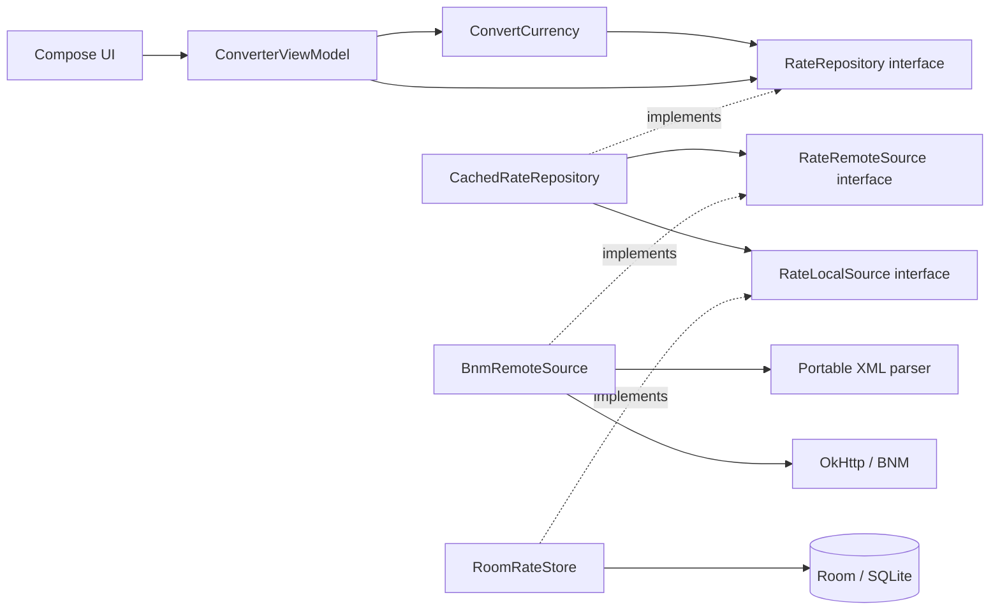

<div align="center">

# 💱 Moldova Currency · Android

**Kotlin · Jetpack Compose · Material 3 · Room · BNM XML**

Официальные курсы, точные расчёты и данные, которые остаются на устройстве.

</div>

## Статус лабораторной №4

**Ветка `feature/base-app`: базовый конвертер реализован и проверен на Pixel 5 (Android 14 / API 34).** Реализация независима от Python-кода лабораторной №3; исходники и тесты написаны заново на Kotlin.

| Этап | Состояние |
|---|---|
| Спецификация и исследование BNM | Завершены, изменения приняты через PR |
| Android-проект, конвертер, Room и загрузка истории | Реализованы в этой ветке, PR ещё предстоит |
| Графики и статистика за 7/30 дней | Следующий этап `feature/analytics` |
| Полный набор Appium/Selenium E2E | Следующий этап `feature/tests` |
| Итоговый REPORT и защита | Предстоят |

Вкладки **7 days** и **30 days** сейчас открывают обозначенные экраны следующего этапа. Это ещё не готовые графики и аналитика.

## Что работает

- MDL, EUR, USD, RON, GBP, UAH; прямая, обратная и cross-currency конвертация.
- Проверка положительного десятичного ввода, Swap и сброс устаревшего результата.
- `BigDecimal`, нормализация Value/Nominal, формула sourceMdl/targetMdl; округление результата HALF_UP до 2 знаков.
- Одинаковые валюты возвращают исходную сумму без запроса курса.
- BNM XML, реальная дата курса, источник и время получения.
- Room-кэш, который переживает завершение процесса и повторный запуск; офлайн-предупреждение.
- Получение истории за текущие 30 календарных дней, не более 3 одновременных запросов; повторное обновление недавних дат и всей истории по Refresh.
- Неполный/невалидный снимок не заменяет валидный сохранённый набор; запросы и фактические даты хранятся отдельно.

## Интерфейс на Pixel 5

| Конвертер | Результат реального BNM-запроса |
|---|---|
|  |  |

Пример за 04.11.2026: 100 USD → 1 806,44 MDL. Это наблюдение конкретного запуска, не фиксированное ожидание будущего теста.

## Открытие и запуск

1. Android Studio → **File → Open** → корневая папка этого репозитория. Второй проект создавать не нужно.
2. Выбери **JDK 17** для Gradle: Settings → Build, Execution, Deployment → Build Tools → Gradle → Gradle JDK. JBR 25 может оставаться средой самой IDE.
3. Дождись Gradle Sync. В Device Manager запусти существующий **Pixel_5 API 34**.
4. Выбери модуль **app** и нажми **Run**.

В PowerShell из корня проекта:

```powershell
$env:JAVA_HOME='C:\Program Files\Eclipse Adoptium\jdk-17.0.18.8-hotspot'
.\gradlew.bat :app:assembleDebug
.\gradlew.bat :app:installDebug
```

Путь JAVA_HOME выше соответствует проверенному компьютеру; на другой машине укажи собственный JDK 17. SDK задаётся Android Studio через `local.properties` либо стандартное локальное окружение. Сам файл local.properties не коммитится.

APK: `app/build/outputs/apk/debug/app-debug.apk`. После установки открой **Moldova Currency** на устройстве.

## Проверки

```powershell
# Все текущие JVM unit-тесты одной командой
.\gradlew.bat :app:testDebugUnitTest

# Детерминированные Android-проверки на указанном эмуляторе
.\scripts\test-device.ps1 -Serial emulator-5554

# Дополнительная проверка живого BNM (нужна сеть)
.\scripts\test-device.ps1 -Serial emulator-5554 -LiveBnm

# Сначала выполни живую загрузку. Затем проверка без сети и после перезапуска:
.\scripts\test-device.ps1 -Serial emulator-5554 -OfflineCache
```

Последний вариант временно включает режим полёта и отключает Wi-Fi **только на указанном эмуляторе**, завершает процесс приложения, проверяет сохранённые данные и восстанавливает исходные настройки в finally. Он не удаляет данные приложения.

| Набор · проверка 04.11.2026 | Результат |
|---|---|
| JVM: валидация, XML, формулы, округление, репозиторий и история | **19 passed** |
| Android: UI-валидация/действие Convert/навигация + 3 Room-проверки | **6 passed** |
| Два опциональных smoke-теста в обычном Android-запуске | Пропускаются без специальных аргументов |
| Живой BNM, отдельный запуск | **1 passed** |
| Кэш после завершения процесса без сети, отдельный запуск | **1 passed** |

Опциональные smoke-тесты не входят в обязательный детерминированный набор. Они не заменяют будущие Appium/Selenium E2E. В этой среде `connectedDebugAndroidTest` не смог получить результаты UTP, поэтому scripts/test-device запускает тот же AndroidJUnitRunner напрямую через ADB и проверяет его итоговый статус. JVM-отчёт: `app/build/reports/tests/testDebugUnitTest/index.html`.

## Архитектура и SOLID



Представление, расчёт, HTTP, XML и сохранение разделены. Бизнес-логика получает интерфейсы и Clock через конструктор, а не создаёт HTTP/Room сама. Общий репозиторий сохраняет данные независимо от реализации источника. Hilt не нужен для такого внедрения зависимостей. Подменяемость проверяется существующими fake-источниками и временным хранилищем; расширенные контрактные проверки запланированы на тестовый этап.

Стабильные Compose `testTag` и root `testTagsAsResourceId` подготовлены для будущего Appium. Никаких специальных Manifest meta-data для этого нет.

## Зафиксированные версии

| Компонент | Версия |
|---|---|
| Gradle / JDK / AGP | 8.13 / 17 / 8.11.1 |
| Kotlin + Compose compiler plugin | 2.2.21 |
| KSP / Room | 2.2.21-2.0.5 / 2.7.2 |
| Compose BOM / Material 3 | 2025.09.00 / 1.3.2 через BOM |
| compileSdk / targetSdk / minSdk | 36 / 36 / 26 |
| OkHttp / coroutines / kXML2 | 4.12.0 / 1.10.2 / 2.3.0 |

Gradle Wrapper включён в репозиторий и проверяет SHA256 дистрибутива. Библиотека графиков подключится вместе с реализацией аналитики; сейчас неиспользуемая зависимость не добавлена.

## Документы и рабочий процесс

[Спецификация](specs/001-mobile-currency-converter/spec.md) · [План](plan.md) · [Задачи](tasks.md) · [Модель данных](data-model.md) · [Исследование](research.md) · [Приёмка](checklists/acceptance.md) · [REPORT](REPORT.md) · [Проверка базового этапа](docs/phase1-verification.md)

Ветки этапов: specs/mobile-currency-converter → feature/base-app → feature/analytics → feature/tests → docs/final. Изменения main — только через PR. Текущие изменения не закоммичены и не отправлены автоматически.

Antigravity подготовил первоначальные документы; Codex исправил спецификации и реализовал/проверил этот Kotlin-этап. Названия моделей и личный опыт студента в REPORT заполняются только по фактическим сведениям.
