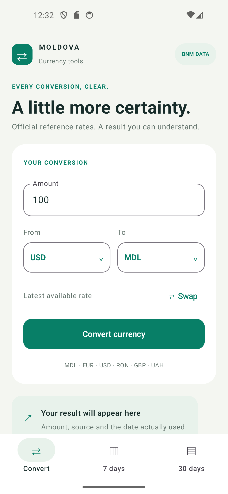
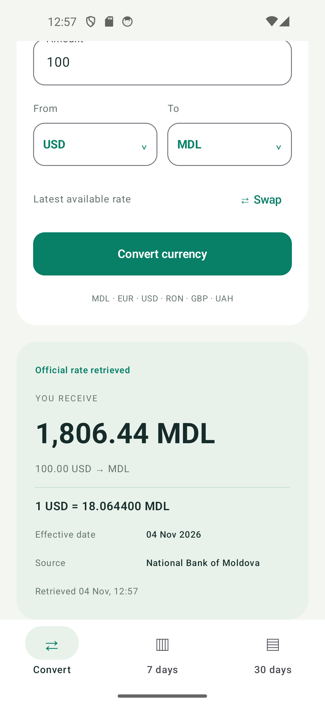
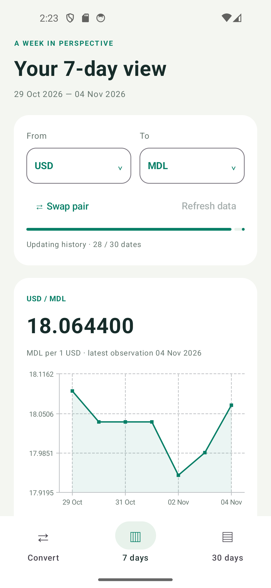
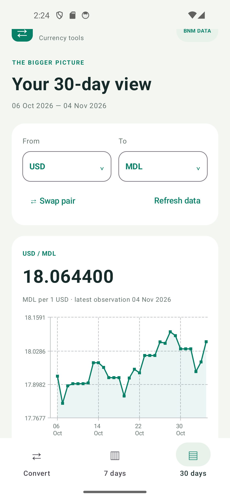
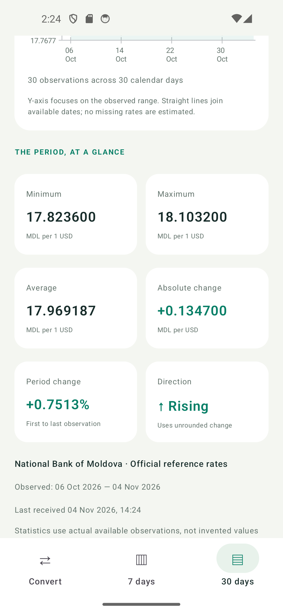
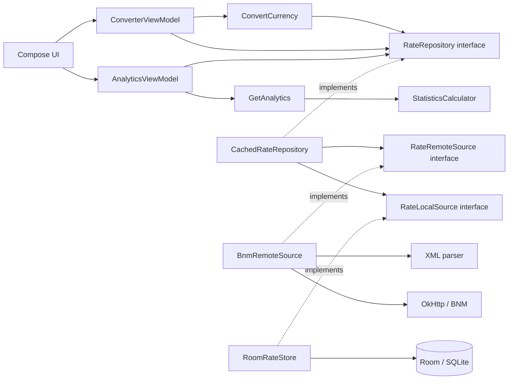

<div align="center">

# 💱 Moldova Currency for Android

**Kotlin · Jetpack Compose · Material 3 · Room · BNM XML**

Convert currencies using official rates from the National Bank of Moldova (BNM), explore exchange-rate trends, and access saved rates offline.

</div>

## Run the app

1. In Android Studio, choose **File → Open** and select the `lab4-currency-converter-android` folder.
2. Set **Gradle JDK** to **JDK 17** under **Settings → Build, Execution, Deployment → Build Tools → Gradle**. Wait for Gradle Sync. The project uses Android SDK 36 to compile.
3. Open **Device Manager** and start **Pixel_5 (API 34)**.
4. Select the **app** run configuration and **Pixel_5**, then click **Run**. Android Studio builds, installs, and opens **Moldova Currency**.

To build and install from PowerShell, start the emulator first and run:

```powershell
cd "C:\Users\user\lab4-currency-converter-android"
$env:JAVA_HOME = 'C:\Program Files\Eclipse Adoptium\jdk-17.0.18.8-hotspot'
.\gradlew.bat :app:assembleDebug
.\gradlew.bat :app:installDebug
```

Open **Moldova Currency** on the emulator after installation. The APK is generated at `app/build/outputs/apk/debug/app-debug.apk`. On another computer, use its local JDK 17 and Android SDK paths. Android Studio can write the SDK path to the ignored `local.properties` file.

Connect the emulator to the internet for the first rate download. Once rates have been saved, the app can use its local cache offline.

## Features

- Convert between MDL, EUR, USD, RON, GBP, and UAH, including cross-currency pairs. Swap the currencies and validate positive decimal amounts before converting.
- Normalize the BNM rate by its nominal quantity and calculate the cross-rate as `sourceMdl / targetMdl`. Calculations use `BigDecimal` and round converted amounts to two decimal places with `HALF_UP`.
- Return the entered amount for a same-currency conversion without requesting a rate.
- Display the effective rate date, data source, and retrieval time. Room keeps valid snapshots across process restarts and the app shows an offline notice when it uses saved data.
- Download rate history for the current 30 calendar days with up to three concurrent requests. The app can refresh recent dates and reload the full history through **Refresh**. Invalid or incomplete downloads leave valid snapshots available.
- Explore **7 days** and **30 days** views with a dated chart, minimum, maximum, mean, absolute change, percentage change, and trend. The windows end today and use the effective dates available in Room. A single observation provides the minimum, maximum, and mean. Change metrics require a comparison.

## Screenshots from Pixel 5

| Converter | Conversion result and source |
| --- | --- |
|  |  |

The screenshots capture a live BNM result from November 4, 2026, when 100 USD converted to 1,806.44 MDL.

| 7-day chart | 30-day chart | 30-day statistics |
| --- | --- | --- |
|  |  |  |

The charts connect available observations and scale the vertical axis to the observed range. Color, text, and an arrow indicate the trend.

## Tests

Run these commands from the repository root with JDK 17 selected. Start the emulator before running the device and Appium suites.

```powershell
.\gradlew.bat :app:testDebugUnitTest
.\scripts\test-device.ps1 -Serial emulator-5554
.\scripts\test-e2e.ps1 -Serial emulator-5554
```

| Suite | Verified result |
| --- | --- |
| JVM unit and provider contract tests | 49 passed |
| Android UI and Room checks on Pixel 5 (Android 14, API 34) | 11 passed |
| Appium/Selenium end-to-end scenarios on Pixel 5 | 6 passed |

The device script invokes AndroidJUnitRunner through ADB. It also supports four optional smoke checks. Run each live check before its corresponding offline check so the emulator has saved data.

```powershell
.\scripts\test-device.ps1 -Serial emulator-5554 -LiveBnm
.\scripts\test-device.ps1 -Serial emulator-5554 -OfflineCache
.\scripts\test-device.ps1 -Serial emulator-5554 -LiveAnalytics
.\scripts\test-device.ps1 -Serial emulator-5554 -OfflineAnalytics
```

The offline checks temporarily disable networking on the selected emulator, restart the app, verify saved data, and restore the previous network settings. The JVM report is generated at `app/build/reports/tests/testDebugUnitTest/index.html`.

The Appium suite uses a separate **Moldova Currency E2E** app with deterministic data and a fixed date of November 4, 2026. It tests forward and reverse cross-currency conversion, both analytics windows, Retry recovery, same-currency conversion without a rate lookup, and cache persistence after an offline restart. It drives the native UI through UiAutomator2, Appium Java Client, and Selenium APIs. [E2E setup](docs/e2e.md) · [Verification results](docs/phase3-verification.md)

## Architecture and SOLID



Room emits dated snapshots through Flow, so the analytics screens update as data arrives. Statistics use decimal arithmetic. Chart rendering converts those values to floating point for Vico.

| Principle | Application in this project |
| --- | --- |
| Single Responsibility | Parsing, storage, calculations, UI state, and presentation have separate components. |
| Open/Closed | New rate sources and stores can implement the existing interfaces. Adding a currency still requires edits to the currency list and UI. |
| Liskov Substitution | Six contract checks exercise the HTTP/XML adapter and the in-memory implementation against shared expectations. |
| Interface Segregation | Remote and local sources have separate interfaces. The repository interface serves both conversion and history. |
| Dependency Inversion | Use cases and ViewModels receive domain interfaces and a clock through constructors. `AppContainer` wires the implementations. |

Appium locates elements through Compose `testTag` values exposed as resource IDs. Dropdown popups enable `testTagsAsResourceId` in their own Compose window.

## Pinned versions

| Component | Version |
| --- | --- |
| Gradle / JDK / Android Gradle Plugin | 8.13 / 17 / 8.11.1 |
| Kotlin and Compose compiler plugin | 2.2.21 |
| KSP / Room | 2.2.21-2.0.5 / 2.7.2 |
| Compose BOM / Material 3 | 2025.09.00 / 1.3.2 via the BOM |
| Compile SDK / Target SDK / Minimum SDK | 36 / 36 / 26 |
| OkHttp / Coroutines / kXML2 | 4.12.0 / 1.10.2 / 2.3.0 |
| Vico Compose Material 3 | 2.2.0 |

The repository includes the Gradle Wrapper and pins the distribution checksum.

## Lab 4 documentation

The Kotlin application and tests were developed for Lab 4 independently of the Python implementation from Lab 3. The repository follows the specification, implementation, analytics, testing, and final report stages. Changes reach `main` through pull requests.

- [Specification](specs/001-mobile-currency-converter/spec.md) · [Plan](plan.md) · [Tasks](tasks.md)
- [Data model](data-model.md) · [Research](research.md) · [Acceptance checklist](checklists/acceptance.md)
- [Base application verification](docs/phase1-verification.md) · [Analytics verification](docs/phase2-verification.md) · [Test suite verification](docs/phase3-verification.md)
- [Lab report](REPORT.md)
