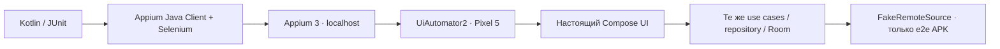

# Appium / Selenium E2E

Тесты написаны на Kotlin и управляют настоящим Compose-интерфейсом через Appium Java Client, Selenium `WebElement`, `By` и `WebDriverWait`. UiAutomator2 работает с Android; ChromeDriver здесь не используется.

## Проверенная конфигурация

| Компонент | Версия |
|---|---|
| JDK / Kotlin JVM | 17 / 2.2.21 |
| Node / npm на проверенном компьютере | 22.19.0 / 10.9.3 |
| Appium server | 3.1.0 |
| UiAutomator2 driver | 5.0.3 |
| Appium Java Client | 9.5.0 |
| Все компоненты Selenium | 4.34.0 |
| JUnit | 4.13.2 |
| Устройство | Pixel_5 · Android14 / API34 |

Пара Java Client/Selenium выбрана по [официальной таблице совместимости](https://github.com/appium/java-client#compatibility-matrix). Требования Node/npm: [Appium3](https://appium.io/docs/en/3.0/quickstart/requirements/). Начиная с major5, [UiAutomator2](https://github.com/appium/appium-uiautomator2-driver) требует Appium3. Все прямые версии заданы точно; npm-транзитивные зависимости зафиксированы в `e2e-tests/appium/package-lock.json`. Gradle принудительно выбирает4.34.0 для каждого артефакта Selenium, исключая открытый диапазон Java Client.

## Запуск

1. Запусти Pixel_5 в Android Studio → Device Manager. Проверь его serial через `adb devices`.
2. В корне проекта выполни:

```powershell
$env:JAVA_HOME='C:\Program Files\Eclipse Adoptium\jdk-17.0.18.8-hotspot'
.\scripts\test-e2e.ps1 -Serial emulator-5554
```

Скрипт берёт SDK из ANDROID_HOME/local.properties, при необходимости устанавливает локальные инструменты Appium, запускает сервер на127.0.0.1:4723, собирает тестовую разновидность APK и запускает Kotlin JVM tests. Созданный им сервер останавливается в finally; чужой сервер не завершается. Для другой машины укажи свой JDK17/SDK. Нужна сеть для первой загрузки зависимостей.

Если сервер Appium уже запущен, скрипт проверяет версию3.1.0. В Codex дочерний процесс, запущенный через Start-Process, может завершаться при закрытии инструментального вызова; при проверке в этой среде сервер поддерживался отдельной активной сессией. В обычном PowerShell сервер и тесты живут в одном выполнении скрипта.

Отдельные команды:

```powershell
.\gradlew.bat -Pe2e=true :app:assembleE2eDebug :e2e-tests:compileTestKotlin
adb -s emulator-5554 install -r app/build/outputs/apk/e2e/debug/app-e2e-debug.apk
# При уже запущенном Appium:
.\gradlew.bat :e2e-tests:test -PrunE2e=true -Pserial=emulator-5554 "-PadbPath=C:\Users\user\AppData\Local\Android\Sdk\platform-tools\adb.exe"
```

Без `-PrunE2e=true` тестовая задача пропускается: обычная сборка не должна требовать телефон и сервер. Обязательный JVM-набор запускается прежней командой `:app:testDebugUnitTest`.

## Изоляция данных и воспроизводимость



Обычные `debug/release` сохраняют исходные задачи и пути APK, реальный BNM и системные часы. `-Pe2e=true` включает flavor `e2e`: отдельный applicationId `md.bnm.currencyconverter.e2e`, название Moldova Currency E2E, фиксированную дату04.11.2026 и тестовый источник. Его код и control receiver отсутствуют в обычном APK.

Разделение выполнено на точке сборки зависимостей: `CurrencyApplication` получает AppBackend; `ProductionBackend` и E2eBackend выбираются исходными наборами Gradle. Формулы, экран, ViewModels, кэш и Room остаются общими. Тестовые сценарии не упрощают расчёты и не заменяют показанный результат готовой строкой.

Данные явно синтетические: USD растёт от17.71 до18.00 за30 календарных дней, EUR=20 MDL; остальные поддерживаемые валюты заданы положительными десятичными значениями. Режимы ready/failure/empty/gaps контролируются только receiver тестового APK. Счётчик запросов позволяет проверить отсутствие нового обращения при EUR→EUR.

Перед каждым независимым сценарием очищается **только тестовый package**. Офлайн-сценарий после загрузки не очищает данные и не переустанавливает приложение: он отключает сеть указанного эмулятора, завершает процесс и запускает его заново. Исходные настройки сети восстанавливаются в finally. Данные обычного приложения не очищаются.

## Проверяемые сценарии

| Сценарий | Независимое ожидание |
|---|---|
| Прямая и обратная cross-конвертация |100USD=90EUR,90EUR=100USD; дата04.11.2026 |
| 7 дней |7 наблюдений; min17.94, max18, mean17.97, delta0.06, +0.3344%, Rising |
| 30 дней |30 наблюдений; min17.71, max18, mean17.855, delta0.29, +1.6375%, Rising |
| Ошибка и Retry |нет фиктивных данных; повторная загрузка после восстановления источника |
| EUR→EUR |123.45 сохраняется, число обращений к источнику не увеличивается |
| Офлайн после перезапуска |Room сохраняет дату, сумму и недельную статистику; предупреждение видно |

Ожидания заданы числами, а не вызовом тестируемого калькулятора. Пропуски, пустой/одиночный ряд и точность дополнительно проверяются доменными/нативными тестами. Стабильные resource-id берутся из Compose testTag; автодобавление package к id отключено в capability.

Результаты: `e2e-tests/build/reports/tests/test/index.html`; XML: `e2e-tests/build/test-results/test/`; снимки и деревья интерфейса: `e2e-tests/build/evidence/`. Фактические итоги конкретного запуска фиксируются отдельно в phase3-verification.md.
